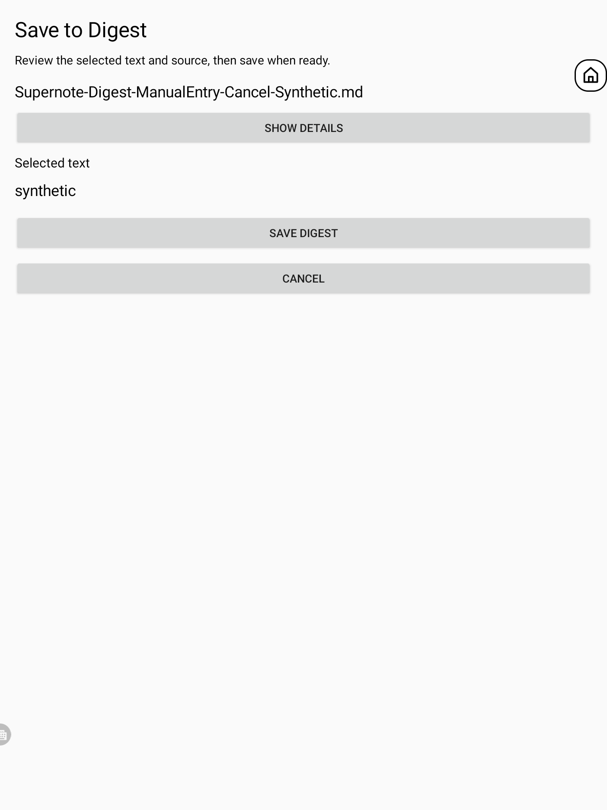

# Save Reader selections as native Digests

Supernote Transcripts 0.15.0 adds an optional Android handoff from MD Reader 2.1.3 to Supernote Bridge 0.4.0. It turns a selected Reader excerpt into a native Digest after the user reviews the quote and source in Bridge and confirms **Save Digest**. Return to Obsidian for the completion acknowledgement.

## Requirements and use

- Obsidian and MD Reader 2.1.3 on a compatible Supernote. Ordinary Markdown capture does not require Transcripts.
- The separate Supernote Bridge 0.4.0 companion app: download `Supernote-Bridge-0.4.0.apk` from the [Transcripts release](https://github.com/ofples/supernote-transcripts/releases/tag/v0.15.0), then install it on the Nomad. Build instructions are in the [helper guide](../scripts/subscription-nomad/android/README.md).
- For managed transcript excerpts, Transcripts 0.15.0 with a matching local `.note` mirror. The adapter validates the source notebook and page identities before handoff. Hidden page chips do not remove the underlying source anchors or their provenance.

Select text in Reader, choose **Save to Supernote Digest**, review the excerpt and source in Bridge, then choose **Save Digest**. The user-facing Bridge review happens before native creation. Return to Obsidian to see the acknowledgement. Reader's local `pending` state means the URI was dispatched but no callback has arrived; reopening that same deterministic request is allowed so Bridge can inspect its durable ledger. It does not mean another provider insert is allowed. Bridge's write lock and durable ledger prevent duplicate inserts: a saved request re-verifies its receipt, provider `PENDING` or `UNCERTAIN` blocks another insert, `CANCELLED` confirms no write and permits a new review and explicit Save, and no ledger entry starts the first Save flow. Bridge also provides **Open original notebook** after save.

Ordinary Markdown excerpts can be sent using the vault-relative source file, heading, and nearby quote context; this path works without the Transcripts plugin or its adapter. The Reader action is Android-only. If Bridge does not open, install or update the APK and select the passage again. Opening the handoff alone never counts as a successful save. Ordinary transcription and reading work without Bridge; native page-link navigation uses its separate existing Notes route.

Actual Nomad confirmation screen using a synthetic test excerpt. Saving requires a separate explicit tap; Cancel returns to Obsidian without creating a Digest.

## Boundaries

Bridge uses the permissioned Supernote provider interface to create and read back a Digest as a native Manual Entry (source type 4). It does not edit `.note` files, write directly to the native database, transmit credentials, or call an AI service. Markdown source context and optional notebook/page metadata are supplied as provenance. For managed transcripts, the source path and page identities are validated against the current local mirror before handoff. Ordinary Markdown files are also retained as provenance, but are not native-tappable sources. The Bridge button opens the supplied notebook/page from the Bridge UI; the Digest's own source action in native Notes is unsupported because Notes requires an embedded reference in the `.note` file. The flow does not modify notebooks or map an excerpt to exact ink coordinates or an ink highlight.

This local provider path is distinct from KOReader's cloud-hosted MariaDB strategy. The implementation does not depend on that service.

## Verification status

Controlled creation, readback, and native visibility of a synthetic Digest were verified. The provider adds its own `unique_identifier`; the native Digest app's source action requires a reference embedded in the `.note` file, which this feature does not write. Native Digest-to-notebook tapping is therefore unsupported. Actual Reader-to-Bridge confirmation and Cancel passed on Nomad for both ordinary Markdown and a managed transcript. The final production Save/acknowledgement/Open-original sequence has not been exercised live; the isolated provider proof and handoff checks are separate. Native cloud sync, Partner behavior, rename handling and cross-device resolution remain unverified.

These results apply to the controlled provider and UI checks only; they do not establish behavior across other firmware versions or sync configurations. See [page-link history](../PAGE_LINKS.md) for the separate existing page-chip navigation feature and its evidence.
