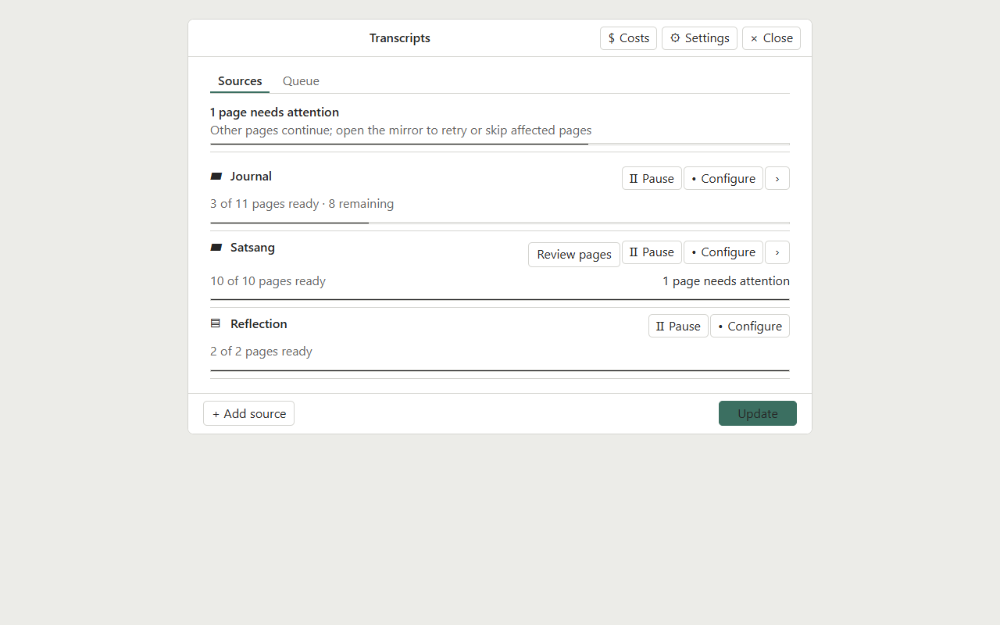
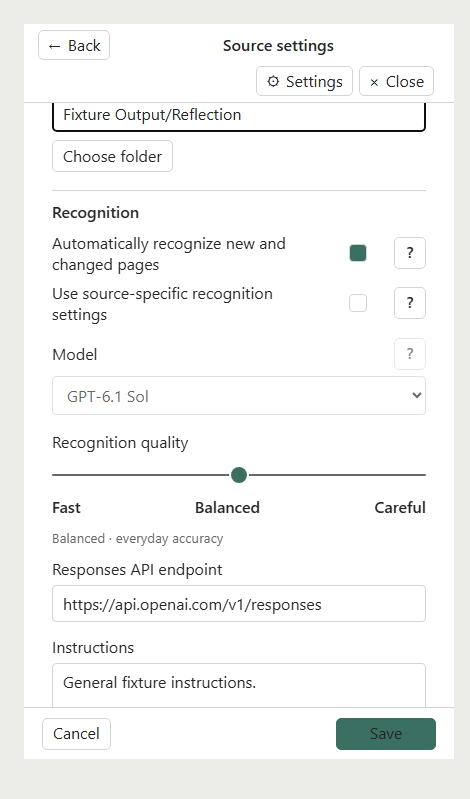
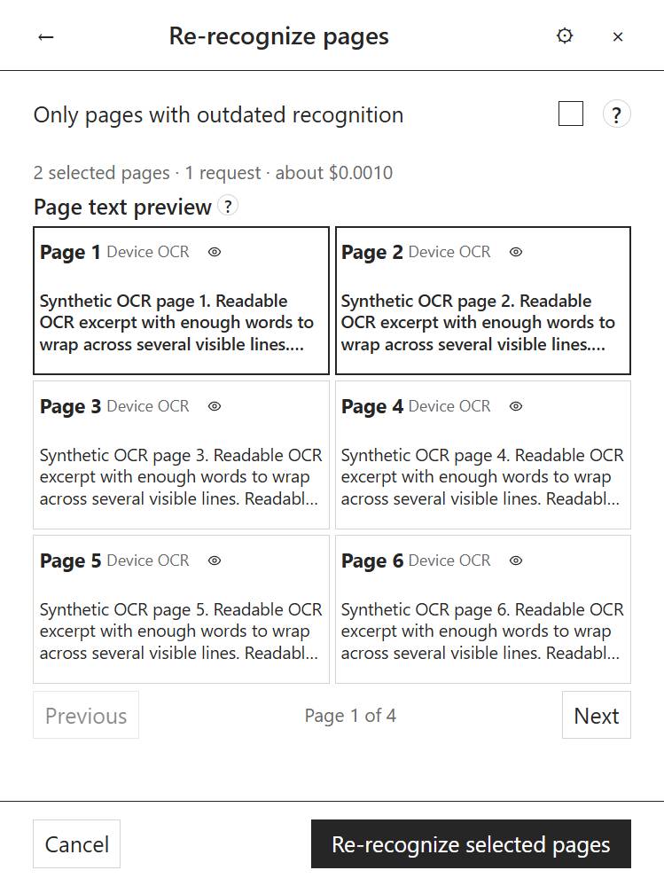
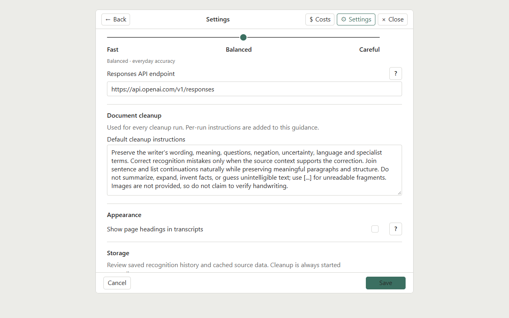
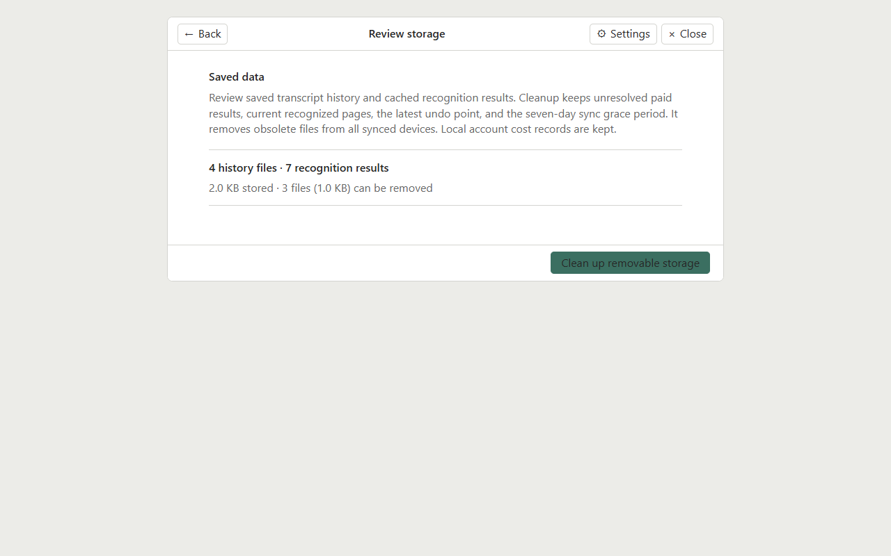
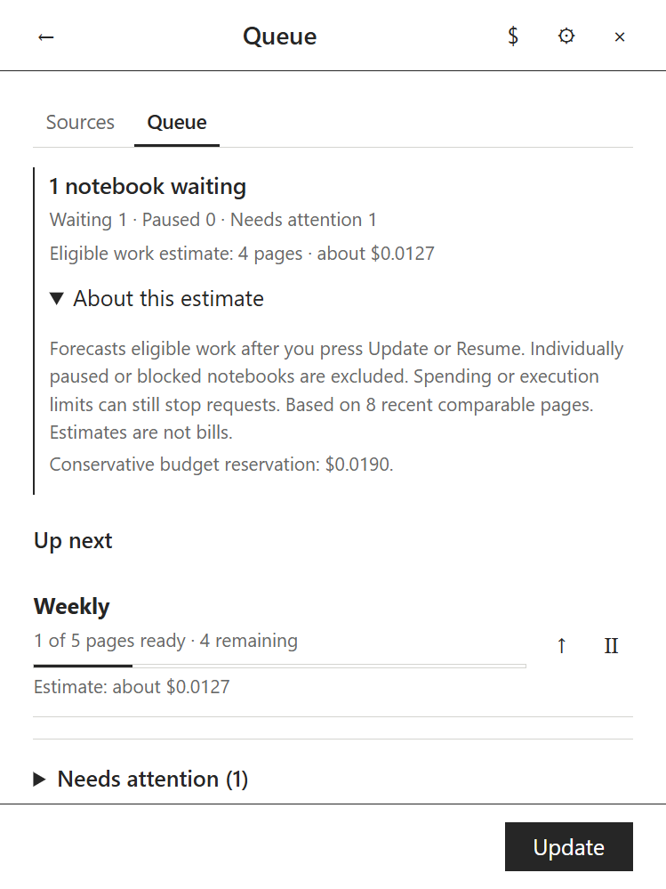
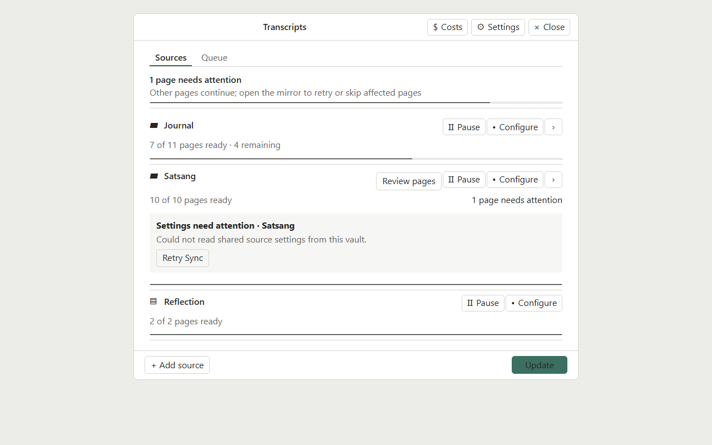

# Interface examples

These are captures of the plugin UI rendered from synthetic fixtures. The notebook labels, paths and OCR excerpts are synthetic; no notebook contents, account data, tokens, settings profiles, or reading positions are included. Screenshots establish layout only, not live-device or provider acceptance.

## Sources overview

The desktop Sources screen shows page progress, attention notices, source controls, and **Update**.

## Source settings

The source editor shows a single-notebook source and the aligned Markdown output folder picker. The picker can find existing folders or open a separate prompt to create one.

The narrow layout stacks the output path and folder button while keeping both aligned to the form's right edge.

The picker uses **Find** to filter folders and a separate prompt to validate and create a new folder.

## Notebook actions

Expanded notebook children keep their row focused on the notebook name, progress and available actions. Open **Details** to reach document workflows.

The notebook Details view keeps cleanup and page re-recognition in a compact action toolbar, with restore controls under a collapsed History disclosure.

Exclusion is confirmed explicitly and keeps the existing transcript.

## Transcript workflows

Cleanup is a text-only operation with a per-run model and estimate. **Save cleaned text as a separate copy** reveals a new Markdown path field; the original transcript remains unchanged.

Re-recognition accepts selected page numbers or ranges and shows a bounded window of device OCR or saved recognition. Each page offers a separate action to preview the original image without selecting it for recognition.

The image Preview action is separate from selecting a page for re-recognition.

## Cleanup defaults and saved data

Default cleanup instructions can be edited in Settings. Per-run additions are entered in the Cleanup workflow.

Saved data shows history/cache counts and the amount eligible for conservative manual cleanup. Restoring a previous transcript is a separate notebook action.

## Queue estimate

The estimate shows four eligible remaining pages, excludes an attention source, and explains the comparable-page basis and conservative reservation.

## Spending pause

The Queue shows that spending limits paused recognition and provides a **Review Costs** action.

## Force update recovery

The warning explains that Force update uses this device’s saved results, creates a backup, and may duplicate requests or replace newer transcript text.

## Shared settings recovery

Conflicting synced settings show the fields that differ and ask which version to keep. A separate sync failure offers **Retry Sync**.

The **Shared mirror** help text summarizes the difference between per-device configuration folders and the Markdown files shared through the vault.

For task instructions see the [user guide](../user-guide.md); for setup see [installation](../installation.md).

## Verification

`node scripts/check-current-ui.mjs` passed 855 assertions for plugin version 0.13.1 at 1280×800 desktop, 470×799 narrow desktop, and 749×999 Nomad-sized viewports. The Nomad-sized Preview action measures 48×44 pixels. The checker used synthetic fixtures only: zero external requests, recognition calls, production Obsidian sessions, or production configuration changes. Browser errors: none.
