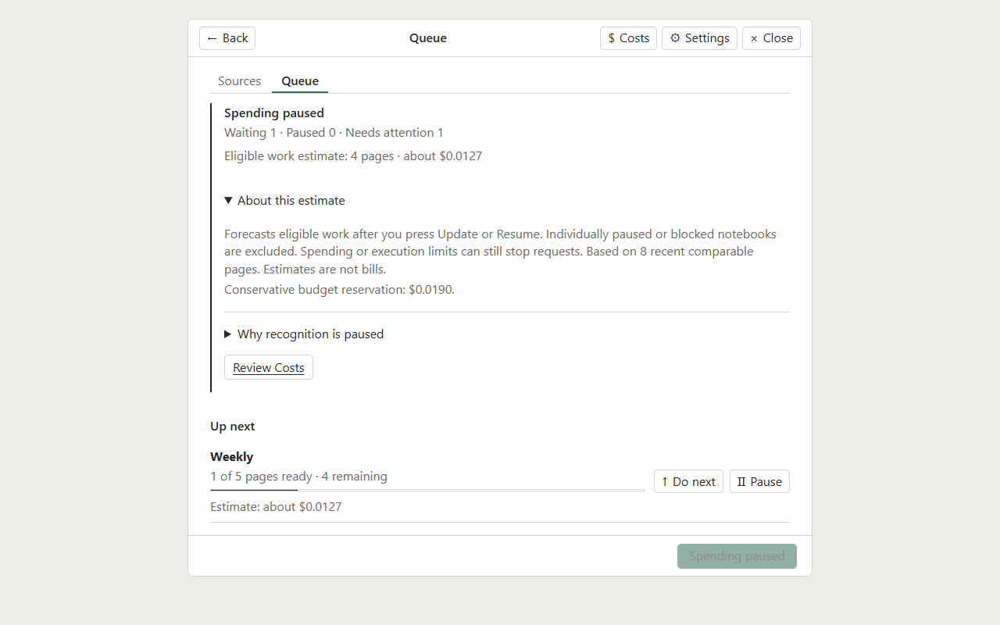

# Interface examples

These are captures of the plugin UI rendered from synthetic fixtures for the 0.12.1 working tree. The fixture run reported 375 assertions across desktop, narrow desktop, and Nomad-sized layouts, with no production Obsidian use, external requests, recognition calls, browser errors, or fixture mutations. The notebook labels and paths are fixture display values; no notebook contents, account data, tokens, settings profiles, or reading positions are included. These screenshots show layout and controls; they do not establish a live Nomad installation or release status.

## Sources overview

The desktop Sources screen shows page progress, attention notices, source controls, and **Update**.

## Source settings

The source editor shows a single-notebook source and the aligned Markdown output folder picker.

## Queue estimate

The estimate shows four eligible remaining pages, excludes an attention source, and explains the comparable-page basis and conservative reservation.

## Spending pause

The Queue shows that spending limits paused recognition and provides a **Review Costs** action.

## Shared settings recovery

Conflicting synced settings show the fields that differ and ask which version to keep. A separate sync failure offers **Retry Sync**.

The **Shared mirror** help text summarizes the difference between per-device configuration folders and the Markdown files shared through the vault.

For task instructions see the [user guide](../user-guide.md); for setup see [installation](../installation.md).
