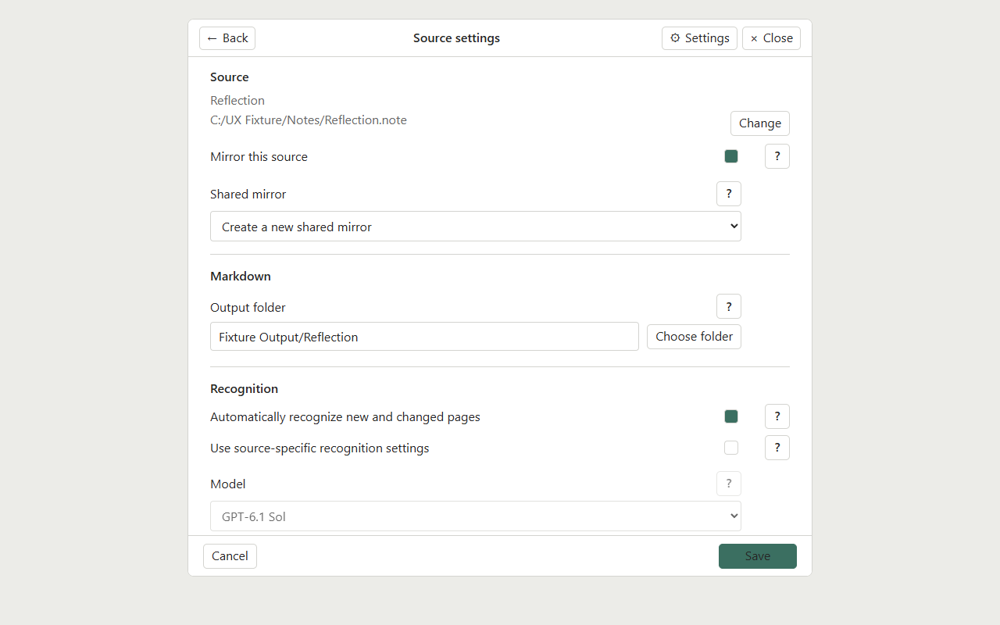
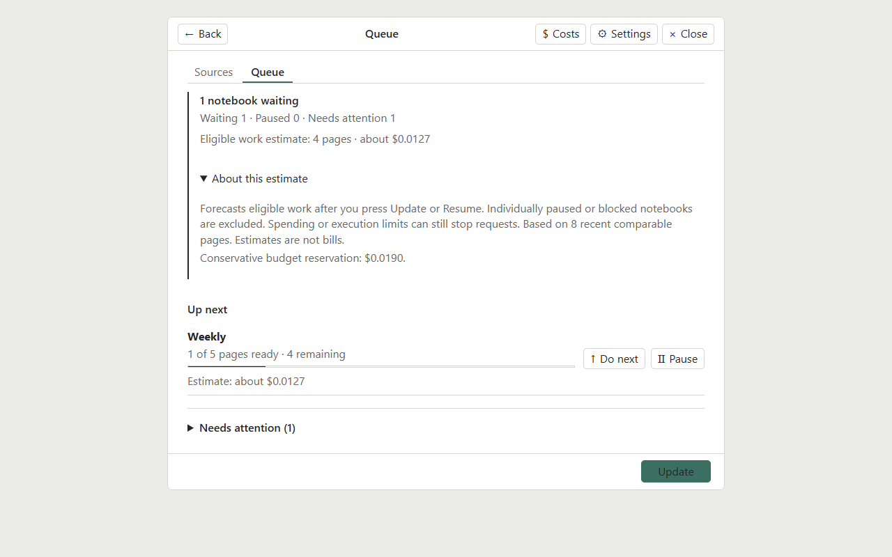
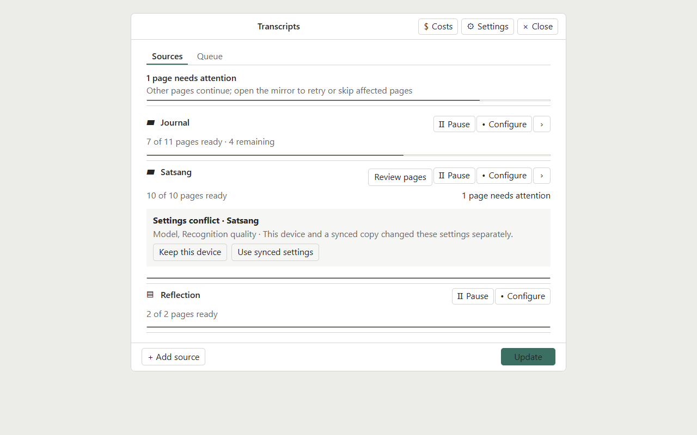

# User guide

Supernote Transcripts turns selected Supernote notebooks into Markdown using a provider you configure. It reads local `.note` files and keeps recognition results so later updates can focus on new or changed pages.

## Add a notebook

1. Run **Supernote Transcripts: Open mirrors** from Obsidian’s command palette.
2. Choose **Add source** and select a `.note` file or folder. A **Mirror** shortcut saves a source with defaults; open its settings afterward to review them.
3. Choose the Markdown destination. For folders, select which notebooks to include and check exclusions.
4. Review the recognition model, quality, prompt and optional glossary. Save the source.
5. Leave automatic catch-up off while learning the workflow. When ready, select **Update** to start an explicit run.

For notebook folders, narrower rules can select a single `.note` file. If multiple enabled rules cover a path, the more specific source path takes precedence.

*Example source settings rendered from a synthetic fixture.*

## Connect a provider

Open **Supernote Transcripts: Open mirrors**, then choose **Settings** in the plugin header. Under **Connection**, choose one provider for recognition on this device. Provider choice and credentials are device-local; shared source settings do not copy them.

### API key

1. Choose **API (pay per request)**.
2. Enter an API key issued by your provider. It is stored on this device.
3. In **Recognition**, set the **Responses API endpoint** to the complete endpoint URL your provider documents. The default is `https://api.openai.com/v1/responses`. Use an endpoint that implements the Responses API; do not add credentials, query strings, or fragments to the URL.
4. Select a listed model or enter a custom model identifier that your endpoint supports. The plugin cannot guarantee that a provider account has access to a selected model. Check the provider’s own billing and model-access information. Estimates and local budgets are described below.
5. Save settings. Keep recognition paused until the provider, model, output, and estimated usage are reviewed.

The endpoint can also be set on a source when it uses source-specific recognition settings. If the provider uses different model identifiers or rates, estimates may be provisional or unavailable until you configure matching pricing in **Costs and limits**.

### ChatGPT subscription

Subscription sign-in needs a current Obsidian release with encrypted SecretStorage. The manifest minimum version does not by itself guarantee subscription sign-in support.

On desktop, choose **ChatGPT subscription** and **Connect ChatGPT account**. Complete authorization in the browser that opens. The encrypted account session stays in that Obsidian installation.

On Nomad, use desktop-assisted pairing:

1. On desktop, open the Transcripts panel, choose **Settings → ChatGPT subscription**, then **Connect a Nomad**. Leave desktop Obsidian open and copy the displayed address and temporary pairing code.
2. Keep Nomad and desktop on the same Wi-Fi network. In Nomad’s **Sign in from desktop** section, tap **Discover** after the pairing locator has synced, or enter the desktop address manually. Enter the separate code and tap **Connect**.
3. Finish authorization in the browser opened on desktop, then complete **Finish sign-in** on Nomad if prompted. The Nomad stores its own encrypted session; desktop credentials are not copied.

If discovery does not find the desktop, confirm the same vault has synced, pairing is active on desktop, and both devices can reach each other on the same private Wi-Fi. Manual address entry is available. Nomad’s Settings has a browser sign-in fallback under **Advanced**; that callback flow uses the separate Android helper. Use it only if the helper and browser flow are available and complete successfully on your device. The helper is not required for ordinary transcript creation or desktop-assisted pairing, and this source checkout does not include a packaged APK.

Subscription mode shows this plugin’s local request/activity accounting, not the account’s remaining plan allowance. It does not display a dollar charge estimate for the ChatGPT plan. Check your account’s current terms and usage controls separately; the plugin does not promise a specific quota or model availability.

## Improve names and terms

A glossary helps recognition retain names, technical vocabulary, and spelling. Create or edit a plain UTF-8 Markdown glossary file in the vault and select it in the source’s glossary list. Keep a glossary focused on terms that are easy to misrecognize. The file is read as reference text; selecting it does not rewrite the glossary.

The prompt guides how the provider handles handwriting, line wraps, page continuity, and output format. Keep the default unless you have a clear need. Custom prompts are saved per source/profile. Model and quality affect output and usage; compare their labels and the estimate before a run. Handwriting recognition depends on the source image and model and can still make mistakes. Review important text against the original notebook.

The quality modes group page requests differently:

| Mode | Target pages per request | Neighbor context | Reasoning |
| --- | ---: | --- | --- |
| Fast | 1 | None | Low |
| Balanced | Up to 4 consecutive pages | 1 nearby page on either side, plus up to 12,000 characters of saved transcript context | Medium |
| Careful | Up to 4 consecutive pages | 2 nearby pages on either side, plus up to 24,000 characters of saved transcript context | High |

Neighbor pages are context only; the request targets only the pending pages. Grouped modes can reduce request count while using more context and a higher reasoning setting. They do not guarantee a more accurate result.

Device OCR text may be shown provisionally while AI recognition is still pending. It is separate from saved AI recognition and is supplied only as a secondary hint; the page image remains authoritative. OCR text is not a completed or verified transcript. Review the recognized Markdown against the original handwriting.

## Review costs and run safely

Recognition may consume paid API usage or subscription capacity. Before enabling a provider, confirm its billing terms and configure any available local request and dollar limits. Estimates use prior comparable pages when available; with little history, estimates are provisional and rely on token assumptions. Estimates are not bills or guaranteed caps. API reservations and subscription attempt counters are local plugin accounting; they do not show the provider account’s remaining quota or replace provider-side limits.

A cautious first run:

- Keep the global worker paused while configuring.
- Select one small notebook and inspect the model, quality, prompt, glossary and estimate.
- Turn on recognition only when you are ready to send pages. Choose **Update** for a manual run.
- Watch Queue and stop new work with **Pause** if needed. An in-flight request may finish and may be billable.
- Check the generated Markdown before expanding to more notebooks.

*Example estimate from a synthetic fixture. It is guidance, not a bill.*

Automatic catch-up can process new and changed pages when Obsidian starts/resumes or at the configured interval while Obsidian is active. It is optional and does not provide continuous Android background execution. Queues, progress, provider connection, budgets, worker concurrency and pause state are local to each device. A paused device does not pause another device’s queue.

Failed pages remain visible for review and are not retried automatically. Use **Retry** when you want another attempt; **Skip** leaves a page out until you choose to retry it. Uncertain interrupted attempts can count against configured ceilings because a provider may have received the request even if no result returned.

## Maintain a transcript

Open a notebook’s actions to see its page progress and saved transcript. **Clean up document** sends the existing transcript text for a text-only cleanup request; it does not resend notebook images. Review the estimate first. You can save the cleanup as a separate copy; otherwise the previous version is retained in history. Cleanup may alter text, so compare the result with the source before relying on it.

**Re-recognize pages** explicitly sends selected page images again. This may use provider credit and can replace transcript content for those pages. Save or copy important edits before re-recognizing. Re-recognition is not automatic after changing a prompt or model.

When source pages change, use **Update** to detect and process the changes. Keep original notebooks and transcript backups until the new output is checked. Concurrent edits or delayed Sync can create conflicts; resolve conflicts after both devices finish syncing and preserve the copy you want.

## View original pages

Transcript page links are optional navigation aids. On Nomad, opening a link in native Notes requires the separate **Supernote login helper** Android app (package `tools.supernote.logincallback`, version 0.2.0 or later). The helper is not required to create transcripts; install it only if you want native page navigation. On desktop, the plugin opens the current page in a compatible enabled `.note` viewer when one handles the notebook; otherwise it renders a read-only original-page preview itself. The optional MD Reader adapter can improve link display in Reading and Live Preview, but page links also appear in standard Obsidian views. Paper and Sidebar are independent options and are not required for transcripts or links.

## Use the same source on two devices

Choose the same Shared mirror for matching notebooks on both devices, then configure the source’s local path separately on each one. Keep a separate Obsidian configuration folder/profile per device (for example, `.obsidian` on desktop and `.obsidian-supernote` on Nomad). Install the plugin in each active profile and do not copy `data.json` or state slots between devices. Obsidian Sync profile/configuration choices control those local files; see [Obsidian Sync settings](https://obsidian.md/help/sync/settings). Sync `Supernote Transcripts/Shared Data/` and the transcript output folder. Provider credentials, queues, daily limits, accounting, automatic settings and pause remain device-local. Shared settings do not transfer credentials or start recognition. Delayed Sync cannot guarantee a single request across devices, and simultaneous Markdown writes can need conflict resolution.

*Example conflict rendered from a synthetic fixture.*

For full installation and original-file safety, see [Installation](installation.md). For recovery symptoms, see [Troubleshooting](troubleshooting.md).
