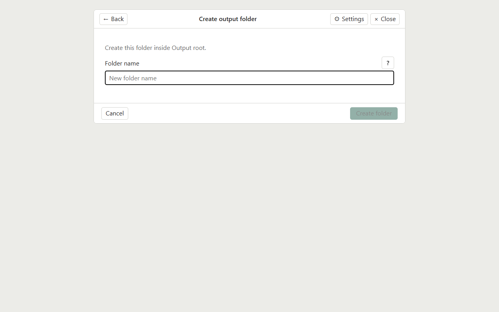
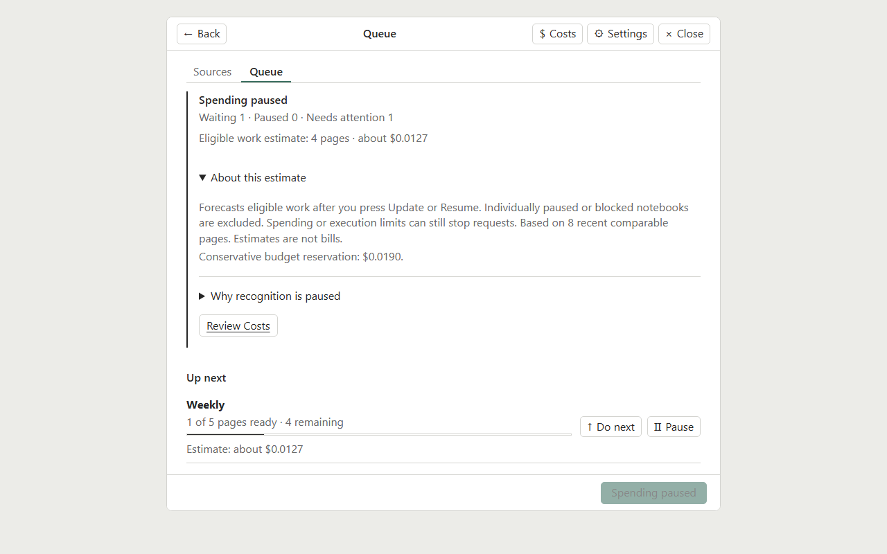
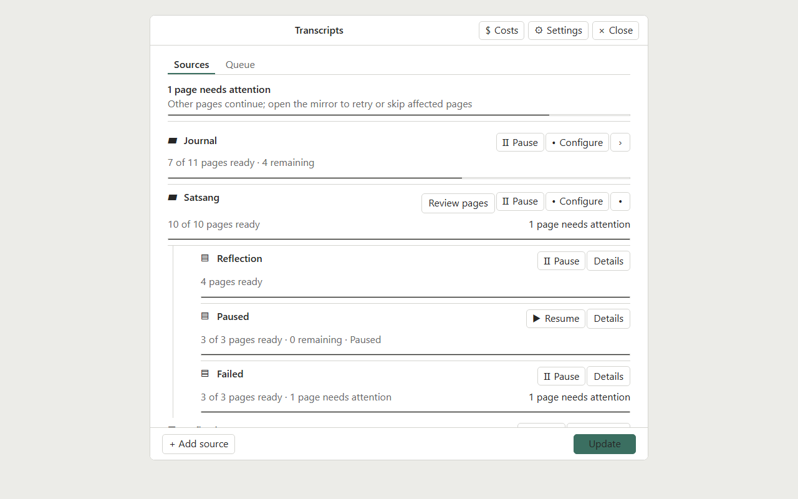
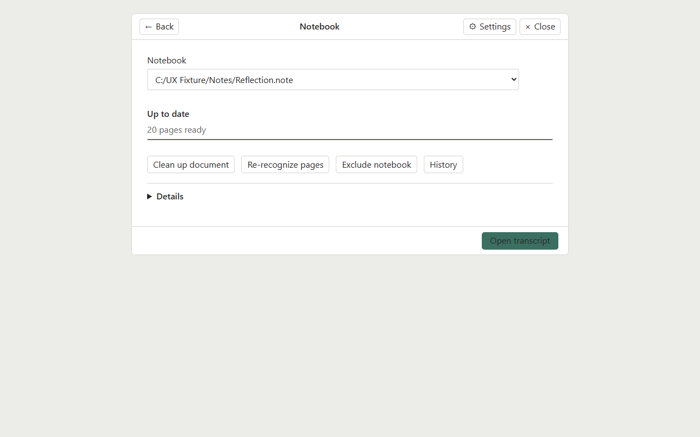
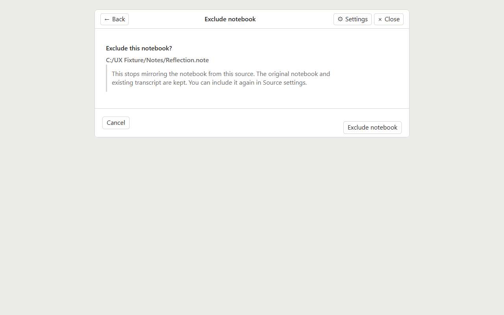
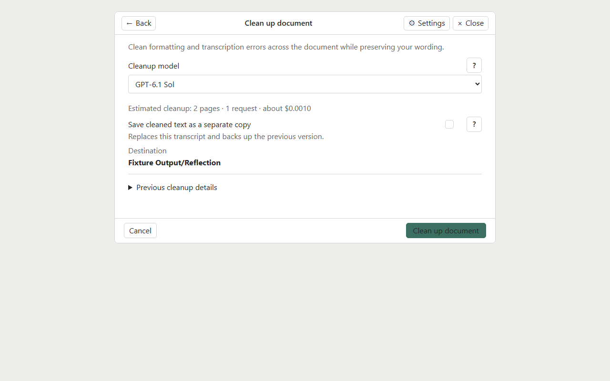
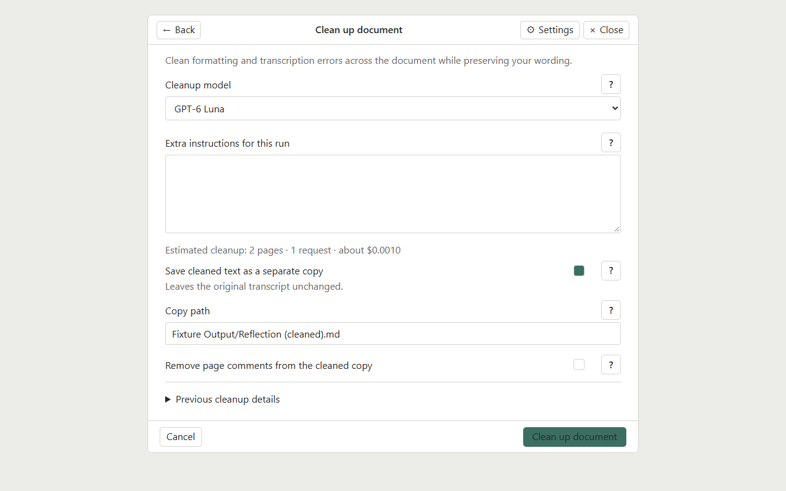
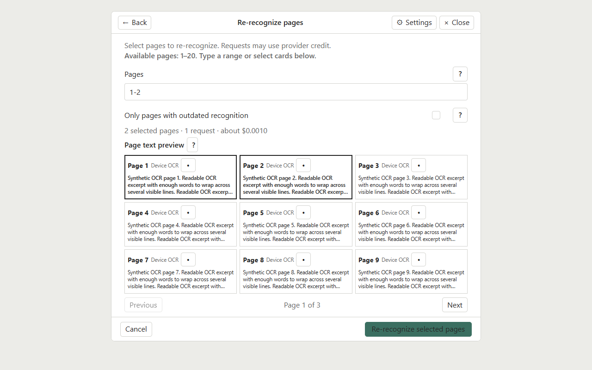
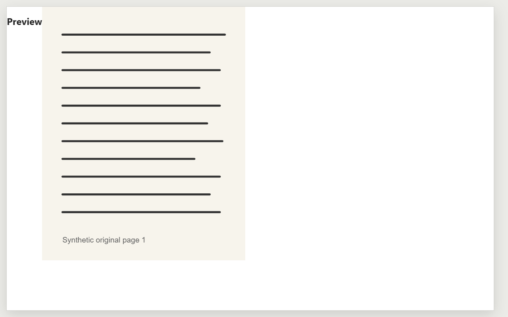
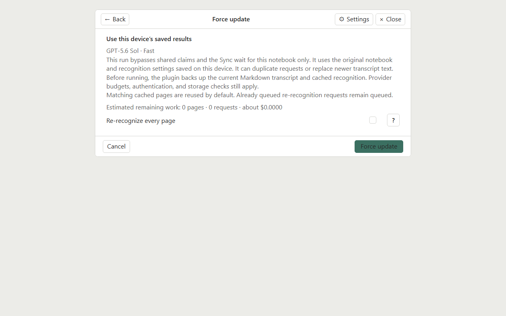

# User guide

Supernote Transcripts turns selected Supernote notebooks into Markdown using a provider you configure. It reads local `.note` files and keeps recognition results so later updates can focus on new or changed pages.

## Add a notebook

1. Run **Supernote Transcripts: Open mirrors** from Obsidian’s command palette.
2. Choose **Add source** and select a `.note` file or folder. A **Mirror** shortcut saves a source with defaults; open its settings afterward to review them.
3. Choose the Markdown destination. In the folder picker, use **Find** to narrow the folder list. **Create** opens a name prompt; confirm a valid name to create it, or cancel to return to the picker. For folder sources, select which notebooks to include and review exclusions before saving.
4. Review the recognition model, quality, prompt and optional glossary. Save the source.
5. Leave automatic catch-up off while learning the workflow. When ready, select **Update** to start an explicit run.

For notebook folders, narrower rules can select a single `.note` file. If multiple enabled rules cover a path, the more specific source path takes precedence.

*Example source settings rendered from a synthetic fixture.*

The output folder picker can filter existing folders. Choose **Create** to name a new folder; invalid names are shown in the prompt and cancelling leaves the vault unchanged.

## Connect a provider

Open **Supernote Transcripts: Open mirrors**, then choose **Settings** in the plugin header. Under **Connection**, choose one provider for recognition on this device. Provider choice and credentials are device-local; shared source settings do not copy them.

### API key

1. Choose **API (pay per request)**.
2. Enter an API key issued by your provider. It is stored on this device.
3. In **Recognition**, set the **Responses API endpoint** to the complete endpoint URL your provider documents. The default is `https://api.openai.com/v1/responses`. Use an endpoint that implements the Responses API; do not add credentials, query strings, or fragments to the URL.
4. Select a listed model or enter a custom model identifier that your endpoint supports. The plugin cannot guarantee that a provider account has access to a selected model. Check the provider’s own billing and model-access information. Estimates and local budgets are described below.
5. Save settings. Keep recognition paused until the provider, model, output, and estimated usage are reviewed.

The endpoint can also be set on a source when it uses source-specific recognition settings. If the provider uses different model identifiers or rates, estimates may be provisional or unavailable until you configure matching pricing in **Costs and limits**.

### ChatGPT subscription

Subscription sign-in needs a current Obsidian release with encrypted SecretStorage. The manifest minimum version does not by itself guarantee subscription sign-in support.

On desktop, choose **ChatGPT subscription** and **Connect ChatGPT account**. Complete authorization in the browser that opens. The encrypted account session stays in that Obsidian installation.

On Nomad, use desktop-assisted pairing:

1. On desktop, open the Transcripts panel, choose **Settings → ChatGPT subscription**, then **Connect a Nomad**. Leave desktop Obsidian open and copy the displayed address and temporary pairing code.
2. Keep Nomad and desktop on the same Wi-Fi network. In Nomad’s **Sign in from desktop** section, tap **Discover** after the pairing locator has synced, or enter the desktop address manually. Enter the separate code and tap **Connect**.
3. Finish authorization in the browser opened on desktop, then complete **Finish sign-in** on Nomad if prompted. The Nomad stores its own encrypted session; desktop credentials are not copied.

If discovery does not find the desktop, confirm the same vault has synced, pairing is active on desktop, and both devices can reach each other on the same private Wi-Fi. Manual address entry is available. Nomad’s Settings has a browser sign-in fallback under **Advanced**; that callback flow uses the separate Android helper. Use it only if the helper and browser flow are available and complete successfully on your device. The helper is not required for ordinary transcript creation or desktop-assisted pairing, and this source checkout does not include a packaged APK.

Subscription mode shows this plugin’s local request/activity accounting, not the account’s remaining plan allowance. It does not display a dollar charge estimate for the ChatGPT plan. Check your account’s current terms and usage controls separately; the plugin does not promise a specific quota or model availability.

## Improve names and terms

A glossary helps recognition retain names, technical vocabulary, and spelling. Create or edit a plain UTF-8 Markdown glossary file in the vault and select it in the source’s glossary list. Keep a glossary focused on terms that are easy to misrecognize. The file is read as reference text; selecting it does not rewrite the glossary.

The prompt guides how the provider handles handwriting, line wraps, page continuity, and output format. Keep the default unless you have a clear need. Custom prompts are saved per source/profile. Model and quality affect output and usage; compare their labels and the estimate before a run. Handwriting recognition depends on the source image and model and can still make mistakes. Review important text against the original notebook.

The quality modes group page requests differently:

| Mode | Target pages per request | Neighbor context | Reasoning |
| --- | ---: | --- | --- |
| Fast | 1 | None | Low |
| Balanced | Up to 4 consecutive pages | 1 nearby page on either side, plus up to 12,000 characters of saved transcript context | Medium |
| Careful | Up to 4 consecutive pages | 2 nearby pages on either side, plus up to 24,000 characters of saved transcript context | High |

Neighbor pages are context only; the request targets only the pending pages. Grouped modes can reduce request count while using more context and a higher reasoning setting. They do not guarantee a more accurate result.

Device OCR text may be shown provisionally while AI recognition is still pending. It is separate from saved AI recognition and is supplied only as a secondary hint; the page image remains authoritative. OCR text is not a completed or verified transcript. Review the recognized Markdown against the original handwriting.

### Careful mode progress

In Careful mode, Queue shows the page currently being prepared and labels a neighboring image as **Context page**. The active request’s target pages are shown separately from context pages. Nearby images rendered for one group may be reused by later groups while they remain in the temporary in-memory cache. Image preparation runs one group at a time, while AI requests can still run in parallel. If you pause during a render, the current image finishes and no new images start. An AI request already in flight may finish.

## Review costs and run safely

Recognition may consume paid API usage or subscription capacity. Before enabling a provider, confirm its billing terms and configure any available local request and dollar limits. Estimates use prior comparable pages when available; with little history, estimates are provisional and rely on token assumptions. Estimates are not bills or guaranteed caps. API reservations and subscription attempt counters are local plugin accounting; they do not show the provider account’s remaining quota or replace provider-side limits.

A cautious first run:

- Keep the global worker paused while configuring.
- Select one small notebook and inspect the model, quality, prompt, glossary and estimate.
- Turn on recognition only when you are ready to send pages. Choose **Update** for a manual run.
- Watch Queue and stop new work with **Pause** if needed. An in-flight request may finish and may be billable.
- Check the generated Markdown before expanding to more notebooks.

*Example estimate from a synthetic fixture. It is guidance, not a bill.*

*Example recovery state from a synthetic fixture. Review the budget before resuming work.*

Automatic catch-up can process new and changed pages when Obsidian starts/resumes or at the configured interval while Obsidian is active. It is optional and does not provide continuous Android background execution. Queues, progress, provider connection, budgets, worker concurrency and pause state are local to each device. A paused device does not pause another device’s queue.

Before AI work begins, Update checks the page counts and order in changed notebooks. It checks up to two notebooks at once on Nomad and four on desktop, without rendering page images or making recognition requests. Unchanged notebooks reuse their previous inventory. Sources and Queue refresh as these checks finish, so a later notebook does not have to wait for an earlier one to finish recognition before its page count updates. Each device keeps its own queue.

Queue keeps the overall progress summary compact. Open **Details** on the active item for the current stage, page, and additional progress information. The existing notebook details/action icon is also the entry point for notebook actions.

Failed pages remain visible for review and are not retried automatically. Use **Retry** when you want another attempt; **Skip** leaves a page out until you choose to retry it. Uncertain interrupted attempts can count against configured ceilings because a provider may have received the request even if no result returned.

## Maintain a transcript

Open a notebook’s details to see its progress and saved transcript. For a notebook inside a folder source, use the child row’s **Details** action to open the same view. The compact action toolbar opens **Clean up document** and **Re-recognize pages**. **History** is collapsed until you need the previous-version restore action. Excluding a notebook asks for confirmation and explains that its saved results remain available if you include it again later.

**Exclude notebook** asks for confirmation and explains that the existing transcript is kept. Cancel returns to notebook details without changing the source.

### Restore the previous transcript version

Before an update replaces generated transcript text, Transcripts keeps one restore point per notebook at `Supernote Transcripts/History/<notebook>/Previous version.md`. It contains the exact previous Markdown and the matching cached recognition snapshot. Open notebook details and use **Restore last version** to put both back. Restoring pauses that notebook so it cannot immediately overwrite the restored version. When you choose **Update** later, recognition uses the current local `.note` file and current source settings.

Obsidian Sync version history is useful for recovering vault files, but it does not replace this restore point: the recognition snapshot and its page provenance are needed to continue updates safely. Keep the local plugin data and state backups too; they are separate from Obsidian Sync.

### Review and clean saved data

In plugin **Settings → Storage → Review storage**, review the listed history and cache files and the removable count before choosing **Clean up removable storage**. Cleanup can remove older tracked transcript or recognition history and unreferenced page results or publication receipts older than seven days. It keeps the current transcript and current page results, the newest saved results and publication, the latest restore point and its recognition data, unresolved or unknown records, malformed/conflicting files, active claims and mirrors, and newly received files. It does not remove local account cost records. Files belonging to removed or no-longer-configured sources are treated as unknown and kept for recovery; a completed source scan may report that the previous transcript remains in the archive.

Cleanup is for old vault history/cache files. It does not delete the plugin's local state snapshots or `state-a`/`state-b` recovery files. Obsidian Sync history and the restore point are complementary safeguards, not a replacement for each other.

### Clean up a transcript

Cleanup sends the existing transcript text for one text-only request; it does not resend notebook images. All notebook pages need saved recognition results before cleanup is available. Before you run it, choose a listed model or enter a custom model ID supported by your provider, then review the estimate. Changing the model applies only to this cleanup and updates its estimate; it does not change the notebook’s saved recognition profile.

By default, cleanup replaces the current generated transcript after preserving the previous version in History. To keep a separate result, turn on **Save cleaned text as a separate copy** and choose a new Markdown file in the vault. The path must be a new `.md` file; it cannot be the existing transcript or a file under `Supernote Transcripts/Shared Data/`. Saving a copy leaves the current transcript and its cleanup record unchanged.

The default cleanup instructions are configurable in plugin settings. Optional instructions entered for one cleanup run are added to that default. **Remove page comments** is available only when saving a separate copy; the mirrored transcript retains its page references. An in-place cleanup keeps those comments and automatically saves the previous transcript version first.

If the transcript or notebook changes while cleanup is running, the paid result is kept in History so you can review it without sending another request. Check the cleaned text against the original handwriting before relying on it. Expand **Previous cleanup details** to see the model, quality, date, and whether the source text has changed since that cleanup.

*Example Cleanup workflow rendered from a synthetic fixture.*

When the separate-copy option is on, the form shows the new path field and confirms the original transcript stays unchanged.

### Re-recognize selected pages

Choose **Re-recognize pages**, enter page numbers or ranges, and review the selection estimate. Available pages are numbered 1 through the notebook's current page count. Page cards show read-only OCR text first and matching saved recognition as a fallback; loading the text does not render page images or send an AI request. Use a card's separate **Preview page N** action to open the original page image. Opening that image does not select the page; use **Select page N** or the page range to choose recognition work. The option to limit the action to pages with outdated recognition helps avoid resending pages that already match the current settings. Re-recognition sends selected page images again, may use provider credit, and can replace transcript text for those pages. Save important manual edits before running it. Changing a prompt or model does not start re-recognition automatically.

Use **Preview page N** to open the original image separately from **Select page N**. Previewing does not select the page for re-recognition.

When source pages change, use **Update** to detect and process the changes. Keep original notebooks and transcript backups until the new output is checked. Concurrent edits or delayed Sync can create conflicts; resolve conflicts after both devices finish syncing and preserve the copy you want.

### Force update for a notebook in conflict

**Force update** appears in notebook details or Sources for failed/conflicted notebooks and certain waits for shared results, synchronization, or another device’s claim. It is an explicit recovery choice. It bypasses shared claims and the Sync wait for that notebook for that invocation only, using this device’s current local notebook and saved recognition settings. Before it runs, the plugin backs up the current Markdown and cached recognition under `Supernote Transcripts/History/`.

By default, matching cached recognition is reused; existing explicit re-recognition work remains queued. The **Re-recognize every page** option sends every current page for recognition, including pages held or skipped earlier. That can create duplicate requests and cost, and publishing this device’s result can replace newer shared transcript text. Check the estimate and compare the local source and saved settings before proceeding. Force update is never automatic. Authentication, AI enablement when re-recognizing all pages, budget, attempt-storage, and saved-state checks still apply. If the transcript is manually edited, use the edit comparison workflow instead of forcing it away.

*Example warning from a synthetic fixture. Check the source and estimate before choosing Force update.*

## View original pages

Transcript page links are optional navigation aids. On Nomad, opening a link in native Notes requires the separate **Supernote login helper** Android app (package `tools.supernote.logincallback`, version 0.2.0 or later). The helper is not required to create transcripts; install it only if you want native page navigation. On desktop, the plugin opens the current page in a compatible enabled `.note` viewer when one handles the notebook; otherwise it renders a read-only original-page preview itself. The optional MD Reader adapter can improve link display in Reading and Live Preview, but page links also appear in standard Obsidian views. Paper and Sidebar are independent options and are not required for transcripts or links.

## Use the same source on two devices

Choose the same Shared mirror for matching notebooks on both devices, then configure the source’s local path separately on each one. Keep a separate Obsidian configuration folder/profile per device (for example, `.obsidian` on desktop and `.obsidian-supernote` on Nomad). Install the plugin in each active profile and do not copy `data.json` or state slots between devices. Obsidian Sync profile/configuration choices control those local files; see [Obsidian Sync settings](https://obsidian.md/help/sync/settings). Sync `Supernote Transcripts/Shared Data/` and the transcript output folder. The portable mirror carries the source’s model, quality, prompt, glossary, output and exclusions; glossary Markdown files must also sync. Provider credentials, local source paths, queues, daily limits, accounting, automatic catch-up and pause remain device-local. Shared settings do not transfer credentials or start recognition. Delayed Sync cannot guarantee a single request across devices, and simultaneous Markdown writes can need conflict resolution.

*Example conflict rendered from a synthetic fixture.*

For full installation and original-file safety, see [Installation](installation.md). For recovery symptoms, see [Troubleshooting](troubleshooting.md).
