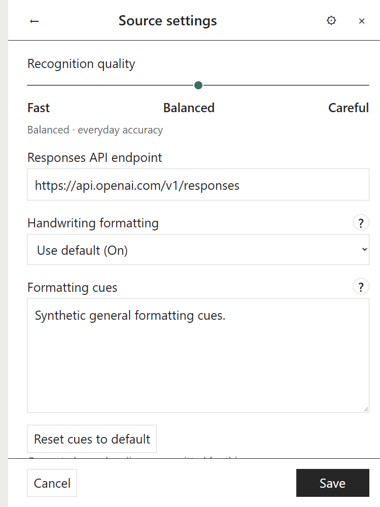

# User guide

Supernote Transcripts turns selected Supernote notebooks into Markdown using a provider you configure. It reads local `.note` files and keeps recognition results so later updates can focus on new or changed pages.

## Where files are stored

Generated Markdown transcripts live under `Supernote Transcripts/` by default. Plugin support files live separately under `_supernote/`: shared mirrors, pairing locators and recognition caches are in `Shared Data/`; restore points are in `History/`; archived transcripts are in `Archive/`; imported glossaries are in `Glossaries/`. The plugin excludes `_supernote/` from Obsidian Search and Quick Switcher results.

The support folder starts with an underscore so Obsidian Sync can sync it. Obsidian Sync excludes dot-prefixed folders (apart from the configuration folder), as described in its [hidden files and folders settings](https://obsidian.md/help/sync/settings). Keep each device’s Obsidian configuration profile separate; plugin data, source paths, queues and credentials remain local where specified below.

Settings are grouped into **Connection**, **Recognition**, **Updates**, and **Storage** tabs. In Storage, choose the support folder and whether it appears in File Explorer or native Search and Quick Switcher. Visibility preferences are device-local; the support folder location follows the shared vault locator. The existing **$** button still opens Costs.

Changing the support folder moves saved recognition, references and history; it does not run AI again. Use a new or empty ordinary vault folder, separate from transcripts and original notebooks. Hidden dot folders cannot travel through Obsidian Sync. Update the plugin on every device before changing this location. The small `_supernote-storage.md` file tells other devices where support data moved; keep it in the vault and sync it. It follows the same visibility/exclusion switches as the support folder. If references use `.txt` or other non-Markdown files, enable syncing those file types too.

If another device is still receiving the moved files, recognition waits rather than repeating completed pages. Keep both devices online, let Obsidian Sync finish, then choose **Retry Sync**. Interrupted local moves resume when Obsidian reloads. Different contents at the same destination are preserved and require resolving the conflicting folders before retrying.

Update Transcripts on every device that runs recognition before reorganizing the vault. Older versions use the former shared-data path and may stop finding shared settings after the move. On startup, the updated plugin preflights moves from the former `Supernote Transcripts/Shared Data/`, `History/`, `Archive/` and `Glossaries/` folders into `_supernote/`. The former `Supernote Transcripts/Transcripts/` output folder is moved into `Supernote Transcripts/`. Custom folders outside those known legacy paths stay where they are. Identical destination files are deduplicated; if both locations contain different contents, migration stops before moving files so you can resolve the conflict. An interrupted move can be retried safely.

This changes paths only. Recognition caches, edited page text, published hashes, per-notebook shared identities, and the last agreed shared-settings baseline are preserved. A moved local output or glossary path is treated as a pending shared-settings change and goes through the normal conflict-aware sync flow. Consolidating a folder records exclusions for existing notebooks left out of that selection, while retaining their transcripts and cached results; notebooks added to the folder later are not part of that exclusion snapshot and can be included by recursive scanning.

## Add a notebook

1. Run **Supernote Transcripts: Open mirrors** from Obsidian’s command palette.
2. Choose **Add source** and select a `.note` file or folder. A **Mirror** shortcut saves a source with defaults; open its settings afterward to review them.
3. Choose the Markdown destination. In the folder picker, use **Find** to narrow the folder list. **Create** opens a name prompt; confirm a valid name to create it, or cancel to return to the picker. For folder sources, select which notebooks to include and review exclusions before saving.
4. Review the recognition model, quality, prompt and optional glossary. Save the source.
5. Leave automatic catch-up off while learning the workflow. When ready, select **Update** to start an explicit run.

Under **Settings → Updates**, choose what automatic catch-up checks on this device: **New pages** detects added pages and page-order changes, **Recent edits** also checks the last 5 pages by default (configurable from 1 to 100), and **All changes** scans every page. These defaults stay local to the device. A source can inherit the default or set its own check mode and recent-page count; source overrides sync with source settings. New-page checks cannot detect changed ink on older pages. If page IDs are missing or ambiguous, the plugin asks for a manual update. Manual **Update** always checks full content and reuses unchanged cached recognition.

For notebook folders, narrower rules can select a single `.note` file. If multiple enabled rules cover a path, the more specific source path takes precedence.

*Example source settings rendered from a synthetic fixture.*

The output folder picker can filter existing folders. Choose **Create** to name a new folder; invalid names are shown in the prompt and cancelling leaves the vault unchanged.

## Connect a provider

Open **Supernote Transcripts: Open mirrors**, then choose **Settings** in the plugin header. Under **Connection**, choose one provider for recognition on this device. Provider choice and credentials are device-local; shared source settings do not copy them.

### API key

1. Choose **API (pay per request)**.
2. Enter an API key issued by your provider. It is stored on this device.
3. In **Recognition**, set the **Responses API endpoint** to the complete endpoint URL your provider documents. The default is `https://api.openai.com/v1/responses`. Use an endpoint that implements the Responses API; do not add credentials, query strings, or fragments to the URL.
4. Select a listed model or enter a custom model identifier that your endpoint supports. The plugin cannot guarantee that a provider account has access to a selected model. Check the provider’s own billing and model-access information. Estimates and local budgets are described below.
5. Save settings. Keep recognition paused until the provider, model, output, and estimated usage are reviewed.

The endpoint can also be set on a source when it uses source-specific recognition settings. If the provider uses different model identifiers or rates, estimates may be provisional or unavailable until you configure matching pricing in **Costs and limits**.

### ChatGPT subscription

Subscription sign-in needs a current Obsidian release with encrypted SecretStorage. The manifest minimum version does not by itself guarantee subscription sign-in support.

On desktop, choose **ChatGPT subscription** and **Connect ChatGPT account**. Complete authorization in the browser that opens. The encrypted account session stays in that Obsidian installation.

On Nomad, use desktop-assisted pairing:

1. On desktop, open the Transcripts panel, choose **Settings → ChatGPT subscription**, then **Connect a Nomad**. Leave desktop Obsidian open and copy the displayed address and temporary pairing code.
2. Keep Nomad and desktop on the same Wi-Fi network. In Nomad’s **Sign in from desktop** section, tap **Discover** after the pairing locator has synced, or enter the desktop address manually. Enter the separate code and tap **Connect**.
3. Finish authorization in the browser opened on desktop, then complete **Finish sign-in** on Nomad if prompted. The Nomad stores its own encrypted session; desktop credentials are not copied.

If discovery does not find the desktop, confirm the same vault has synced, pairing is active on desktop, and both devices can reach each other on the same private Wi-Fi. Manual address entry is available. Nomad’s Settings has a browser sign-in fallback under **Advanced**; that callback flow uses the separate Android helper. Use it only if the helper and browser flow are available and complete successfully on your device. The helper is not required for ordinary transcript creation or desktop-assisted pairing, and this source checkout does not include a packaged APK.

Subscription mode shows this plugin’s local request/activity accounting, not the account’s remaining plan allowance. It does not display a dollar charge estimate for the ChatGPT plan. Check your account’s current terms and usage controls separately; the plugin does not promise a specific quota or model availability.

## Improve names and terms

A glossary helps recognition retain names, technical vocabulary, and spelling. Create or edit a plain UTF-8 Markdown glossary file in the vault and select it in the source’s glossary list. Keep a glossary focused on terms that are easy to misrecognize. The file is read as reference text; selecting it does not rewrite the glossary.

The prompt guides how the provider handles handwriting, line wraps, page continuity, and output format. Keep the default unless you have a clear need. Custom prompts are saved per source/profile. Model and quality affect output and usage; compare their labels and the estimate before a run. Handwriting recognition depends on the source image and model and can still make mistakes. Review important text against the original notebook.

The quality modes group page requests differently:

| Mode | Target pages per request | Neighbor context | Reasoning |
| --- | ---: | --- | --- |
| Fast | 1 | None | Low |
| Balanced | Up to 4 consecutive pages | 1 nearby page on either side, plus up to 12,000 characters of saved transcript context | Medium |
| Careful | Up to 4 consecutive pages | 2 nearby pages on either side, plus up to 24,000 characters of saved transcript context | High |

Neighbor pages are context only; the request targets only the pending pages. Grouped modes can reduce request count while using more context and a higher reasoning setting. They do not guarantee a more accurate result.

Device OCR text may be shown provisionally while AI recognition is still pending. It is separate from saved AI recognition and is supplied only as a secondary hint; the page image remains authoritative. OCR text is not a completed or verified transcript. Review the recognized Markdown against the original handwriting.

### Careful mode progress

In Careful mode, Queue shows the page currently being prepared and labels a neighboring image as **Context page**. The active request’s target pages are shown separately from context pages. Nearby images rendered for one group may be reused by later groups while they remain in the temporary in-memory cache. Image preparation runs one group at a time, while AI requests can still run in parallel. If you pause during a render, the current image finishes and no new images start. An AI request already in flight may finish.

## Review costs and run safely

Recognition may consume paid API usage or subscription capacity. Before enabling a provider, confirm its billing terms and configure any available local request and dollar limits. Estimates use prior comparable pages when available; with little history, estimates are provisional and rely on token assumptions. Estimates are not bills or guaranteed caps. API reservations and subscription attempt counters are local plugin accounting; they do not show the provider account’s remaining quota or replace provider-side limits.

A cautious first run:

- Keep the global worker paused while configuring.
- Select one small notebook and inspect the model, quality, prompt, glossary and estimate.
- Turn on recognition only when you are ready to send pages. Choose **Update** for a manual run.
- Watch Queue and stop new work with **Pause** if needed. An in-flight request may finish and may be billable.
- Check the generated Markdown before expanding to more notebooks.

For a one-time run, choose **Recognize now** on a notebook or source-folder row. A notebook action queues that notebook; a folder action queues its currently included notebooks. It does not enable automatic catch-up or clear another notebook’s pause. It can run while automatic catch-up or the global worker is paused, while keeping those saved preferences in place. Provider connection, AI enablement, usage limits, saved-state integrity, and source eligibility still apply. While a manual run is queued or active, the row’s **Pause manual recognition** action cancels it at that source or notebook; the main **Pause** action pauses the global worker.

*Example estimate from a synthetic fixture. It is guidance, not a bill.*

*Example recovery state from a synthetic fixture. Review the budget before resuming work.*

Automatic catch-up can process new and changed pages when Obsidian starts/resumes or at the configured interval while Obsidian is active. It is optional and does not provide continuous Android background execution. Queues, progress, provider connection, budgets, worker concurrency and pause state are local to each device. A paused device does not pause another device’s queue.

Before AI work begins, Update checks the page counts and order in changed notebooks. It checks up to two notebooks at once on Nomad and four on desktop, without rendering page images or making recognition requests. Unchanged notebooks reuse their previous inventory. Sources and Queue refresh as these checks finish, so a later notebook does not have to wait for an earlier one to finish recognition before its page count updates. Each device keeps its own queue.

Page numbers are display positions, not cache keys. Native page IDs identify pages across insertions and reordering; bitmap fingerprints determine whether their recognition is still current. When a native ID is unavailable, matching content can reuse recognition. Inserting a page normally requires recognition only for the new page, swapping pages changes the output order, and deleting a page removes it from the next transcript. A deleted page containing your Markdown edits uses the explicit edit-recovery flow instead of silently discarding those edits. Device OCR is not used as a change fingerprint, because it may be stale or missing and cannot detect every visual edit.

On Nomad, the local file server may stream from the beginning even when only a later block is needed. Seeing a file-size reading counter again does not itself mean another AI request. The plugin batches device OCR reads, shares a bounded number of verified indexes within an update, and reads nearby target/context images together when they fit the memory limit. It still checks bitmap content before rendering. Large batches fall back to individual reads; no whole-notebook bitmap cache is retained, and large notebooks can still take time to read.

Queue keeps the overall progress summary compact. Tap the **Working now** card or its caret to expand current-stage and page details; page progress remains visible while the card is collapsed. The **?** beside the eligible-work estimate opens its explanation. **Needs attention** stays visible below the active and waiting work. Review and Force update actions appear together beneath a source’s progress when available. The existing notebook details/action icon is also the entry point for notebook actions.

Failed pages remain visible for review and are not retried automatically. Use **Retry** when you want another attempt; **Skip** leaves a page out until you choose to retry it. Uncertain interrupted attempts can count against configured ceilings because a provider may have received the request even if no result returned.

## Maintain a transcript

Open a notebook’s details to see its progress and saved transcript. For a notebook inside a folder source, use the child row’s **Details** action to open the same view. The compact action toolbar opens **Clean up document** and **Re-recognize pages**. **History** is collapsed until you need the previous-version restore action. Excluding a notebook asks for confirmation and explains that its saved results remain available if you include it again later.

### Review page changes

Appending pages sends only those new pages for recognition; existing Markdown corrections and `==highlight==` markup are kept separately from the raw recognition cache. If an existing page image changes, its recognition request also carries the previous recognition text and your edited text so the result can reconcile them. That context adds input tokens to the same request, but does not start an extra automatic request; existing budgets and output limits still apply.

When an existing page has both a manual transcript edit and newer handwriting recognition, notebook details shows **Review changes** with the number of affected pages. Open it to compare **Your edits**, **New handwriting recognition**, and, when available, a **Proposed edit**. Choose **Keep my edits**, **Use updated handwriting**, or **Use proposed edit** for each page. This review makes no AI calls. Transcripts saves a restore point before applying each choice; use **Restore last version** in notebook details if you need to restore the most recent saved version. No text is replaced until you choose an action. New pages are kept automatically and do not need this review. If a page changed while the comparison was open, Transcripts refreshes the current versions so you can review them before choosing again.

If page metadata is missing or unsafe, or a page with edits was removed from the notebook, automatic page reconciliation stops and asks you to use the existing **Resolve edits** or **Force update** recovery flow. These recovery choices back up the current Markdown and recognition data before changing ownership or generated output. Update the local Transcripts plugin on both devices before relying on the shared reconciliation presentation; Markdown may sync between them, but plugin code is installed separately.

**Exclude notebook** asks for confirmation and explains that the existing transcript is kept. Cancel returns to notebook details without changing the source.

### Restore the previous transcript version

Before an update replaces generated transcript text, Transcripts keeps one restore point per notebook at `_supernote/History/<notebook>/Previous version.md`. It contains the exact previous Markdown and the matching cached recognition snapshot. Open notebook details and use **Restore last version** to put both back. Restoring pauses that notebook so it cannot immediately overwrite the restored version. When you choose **Update** later, recognition uses the current local `.note` file and current source settings.

Obsidian Sync version history is useful for recovering vault files, but it does not replace this restore point: the recognition snapshot and its page provenance are needed to continue updates safely. Keep the local plugin data and state backups too; they are separate from Obsidian Sync.

### Review and clean saved data

In plugin **Settings → Storage → Review storage**, review the listed history and cache files and the removable count before choosing **Clean up removable storage**. Cleanup can remove older tracked transcript or recognition history and unreferenced page results or publication receipts older than seven days. It keeps the current transcript and current page results, the newest saved results and publication, the latest restore point and its recognition data, unresolved or unknown records, malformed/conflicting files, active claims and mirrors, and newly received files. It does not remove local account cost records. Files belonging to removed or no-longer-configured sources are treated as unknown and kept for recovery; a completed source scan may report that the previous transcript remains in the archive.

Cleanup is for old vault history/cache files. It does not delete the plugin's local state snapshots or `state-a`/`state-b` recovery files. Obsidian Sync history and the restore point are complementary safeguards, not a replacement for each other.

### Clean up a transcript

Cleanup sends the existing transcript text for one text-only request; it does not resend notebook images. All notebook pages need saved recognition results before cleanup is available. Before you run it, choose a listed model or enter a custom model ID supported by your provider, then review the estimate. Changing the model applies only to this cleanup and updates its estimate; it does not change the notebook’s saved recognition profile.

By default, cleanup replaces the current generated transcript after preserving the previous version in History. To keep a separate result, turn on **Save cleaned text as a separate copy** and choose a new Markdown file in the vault. The path must be a new `.md` file; it cannot be the existing transcript or a file under `_supernote/Shared Data/`. Saving a copy leaves the current transcript and its cleanup record unchanged.

The default cleanup instructions are configurable in plugin settings. Optional instructions entered for one cleanup run are added to that default. **Remove page comments** is available only when saving a separate copy; the mirrored transcript retains its page references. An in-place cleanup keeps those comments and automatically saves the previous transcript version first.

If the transcript or notebook changes while cleanup is running, the paid result is kept in History so you can review it without sending another request. Check the cleaned text against the original handwriting before relying on it. Expand **Previous cleanup details** to see the model, quality, date, and whether the source text has changed since that cleanup.

*Example Cleanup workflow rendered from a synthetic fixture.*

When the separate-copy option is on, the form shows the new path field and confirms the original transcript stays unchanged.

### Re-recognize selected pages

Choose **Re-recognize pages**, enter page numbers or ranges, and review the selection estimate. Available pages are numbered 1 through the notebook's current page count. Page cards show read-only OCR text first and matching saved recognition as a fallback; loading the text does not render page images or send an AI request. Use a card's separate **Preview page N** action to open the original page image. Opening that image does not select the page; use **Select page N** or the page range to choose recognition work. The option to limit the action to pages with outdated recognition helps avoid resending pages that already match the current settings. Re-recognition sends selected page images again, may use provider credit, and can replace transcript text for those pages. Save important manual edits before running it. Changing a prompt or model does not start re-recognition automatically.

Use **Preview page N** to open the original image separately from **Select page N**. Previewing does not select the page for re-recognition.

When source pages change, use **Update** to detect and process the changes. Keep original notebooks and transcript backups until the new output is checked. Concurrent edits or delayed Sync can create conflicts; resolve conflicts after both devices finish syncing and preserve the copy you want.

### Force update for a notebook in conflict

**Force update** appears in notebook details or Sources for failed/conflicted notebooks and certain waits for shared results, synchronization, or another device’s claim. It is an explicit recovery choice. It bypasses shared claims and the Sync wait for that notebook for that invocation only, using this device’s current local notebook and saved recognition settings. Before it runs, the plugin backs up the current Markdown and cached recognition under `_supernote/History/`.

By default, matching cached recognition is reused; existing explicit re-recognition work remains queued. The **Re-recognize every page** option sends every current page for recognition, including pages held or skipped earlier. That can create duplicate requests and cost, and publishing this device’s result can replace newer shared transcript text. Check the estimate and compare the local source and saved settings before proceeding. Force update is never automatic. Authentication, AI enablement when re-recognizing all pages, budget, attempt-storage, and saved-state checks still apply. If the transcript is manually edited, use the edit comparison workflow instead of forcing it away.

*Example warning from a synthetic fixture. Check the source and estimate before choosing Force update.*

## Recognize handwriting formatting

**Recognize handwriting formatting** is on by default in Settings → Recognition. It adds visual-formatting instructions to the existing recognition prompt; it does not replace your saved instructions or attach an extra reference image. In a source's settings, enable **Use source-specific recognition settings**, then choose **Handwriting formatting → Use default / On / Off**. You can also customize **Formatting cues** for that source or reset them to the General defaults. Shared mirrors carry the effective formatting settings to the other device.

The built-in marking guide recognizes these conventions:

| Handwritten mark | Markdown output |
| --- | --- |
| White title on a solid black rectangle | `# Heading` |
| White title on a medium-gray rectangle | `## Heading` |
| Dark title on a light-gray rectangle | `### Heading` |
| Title on a diagonally hatched rectangle | `#### Heading` |
| Line through readable words | `~~crossed-out words~~` |
| Broad, uneven gray marker stroke | `==highlighted words==` |
| Authored line below words | `<u>underlined words</u>` |
| Clear hand-drawn table | Markdown pipe table |

*Synthetic settings example; the cue text is placeholder configuration, not private notebook content.*

Formatting cues describe visual conventions; they are not words to add to your notes. An empty custom cue field removes the inherited marking guide while retaining the general Markdown-formatting rules. The model still reflows handwriting line wraps, preserves meaningful paragraphs and uses `[...]` for unreadable fragments. Notebook ruling and decorative template lines should not become underlines or tables. Cleanup preserves formatting already present in the text; without images it cannot verify new visual formatting.

Generated **Page N** headings are unavailable when default formatting is enabled, and are always omitted for any source whose effective formatting setting is On. Original page-link comments and inline navigation chips remain available. Changing these settings marks earlier results as using older recognition instructions; it does **not** automatically re-recognize existing pages. Use **Re-recognize pages** to apply the new rules to selected existing pages. New or edited pages use the current rules on their next recognition request.

Text guidance adds input tokens to recognition requests. API budgets account for the full prompt, estimates use matching recent results when available, and subscription requests consume the connected plan's allowance. No reference-image upload or extra model call is added by this feature.

## View original pages

Documents with notebook page links have a page-link button beside their reading/editing control. Choose **Hide notebook page links** for an uninterrupted reading view, or **Show notebook page links** to bring them back. The choice applies to that file on this device, including standard Obsidian views and the compatible MD Reader. It does not alter the document, its metadata comments, or recognition. Ordinary documents have no extra button. The command **Show or hide notebook page links by default** changes the default for files without an individual choice.

Transcript page links are optional navigation aids. On Nomad, opening a link in native Notes requires the separate **Supernote Bridge 0.6.1** Android app (package `tools.supernote.logincallback`). The app is not required to create transcripts; install it only if you want native page navigation. On desktop, the plugin opens the current page in a compatible enabled `.note` viewer when one handles the notebook; otherwise it renders a read-only original-page preview itself. The optional MD Reader adapter can improve link display in Reading and Live Preview, but page links also appear in standard Obsidian views. Paper and Sidebar are independent options and are not required for transcripts or links.

### Reader highlights

MD Reader highlights are separate Markdown annotation records; they do not alter the transcript text. When Reader needs to relocate a saved highlight, it requires the exact quote to appear once in a single chapter and checks its saved surrounding context. If the quote or context is ambiguous or no longer matches, Reader leaves the highlight unresolved instead of guessing a new location.

## Use the same source on two devices

Choose the same Shared mirror for matching notebooks on both devices, then configure the source’s local path separately on each one. Keep a separate Obsidian configuration folder/profile per device (for example, `.obsidian` on desktop and `.obsidian-supernote` on Nomad). Install the plugin in each active profile and do not copy `data.json` or state slots between devices. Obsidian Sync profile/configuration choices control those local files; see [Obsidian Sync settings](https://obsidian.md/help/sync/settings). Sync `_supernote/Shared Data/` and the transcript output folder. The portable mirror carries the source’s model, quality, prompt, glossary, output and exclusions; glossary Markdown files must also sync. Provider credentials, local source paths, queues, daily limits, accounting, automatic catch-up and pause remain device-local. Shared settings do not transfer credentials or start recognition. Delayed Sync cannot guarantee a single request across devices, and simultaneous Markdown writes can need conflict resolution.

*Example conflict rendered from a synthetic fixture.*

For full installation and original-file safety, see [Installation](installation.md). For recovery symptoms, see [Troubleshooting](troubleshooting.md).
