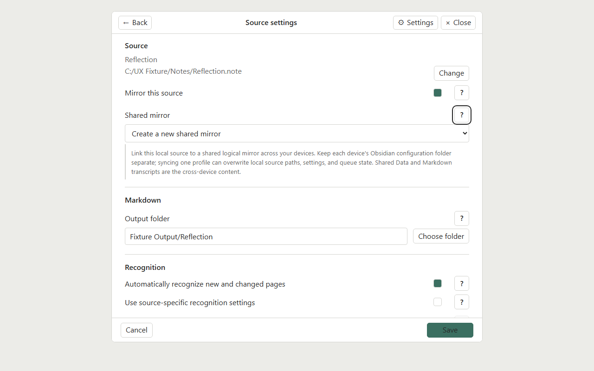

# Nomad and desktop workflow

This guide starts with a new desktop and Nomad setup and connects both to one Obsidian vault. Download Obsidian from the [official download page](https://obsidian.md/download) for Windows, macOS, or Linux; on the Nomad, use the Android APK from that page. Obsidian Sync requires an Obsidian account and active Sync subscription.

The workflow has two independent file paths:

- Supernote Cloud Sync makes original notebook files available between the Nomad and desktop. On desktop, the optional **Supernote Cloud Sync** Obsidian plugin can download notebooks from your Supernote account into a vault folder.
- Obsidian Sync carries transcript Markdown and Transcripts' shared records between the desktop and Nomad. Keep the original `.note` files out of this Sync path.

The names are similar, but these services move different data. Native Supernote Cloud Sync is the Supernote account service used by the device. The desktop [Supernote Cloud Sync plugin](https://github.com/raaneem/supernote-cloud-sync) is an Obsidian client for that service and can also provide a notebook viewer. Obsidian Sync synchronizes vault files and settings between Obsidian installations. Transcripts does not require either Supernote cloud feature; it reads local `.note` files.

## What goes where

| Data | Desktop | Nomad | Transfer path |
| --- | --- | --- | --- |
| Original `.note` notebooks | Local folder, optionally populated by the desktop Supernote Cloud Sync plugin | Local device notebook folder | Nomad → Supernote Cloud → desktop Cloud Sync plugin, or a deliberate local copy/transfer |
| Generated transcript `.md` files | In the vault output folder | Same vault output folder | Obsidian Sync |
| `Supernote Transcripts/Shared Data/` | In the vault | Same vault path | Obsidian Sync |
| Shared mirror definition (source selection, output, prompt, endpoint, model, quality, glossary paths) | Markdown records in `Shared Data` | Same Markdown records | Obsidian Sync |
| Source file paths, API credentials, sign-in sessions, queue/progress, budgets, pause and automatic-run switch | Desktop's Obsidian configuration/data | Nomad's separate configuration/data | Local to each device; do not copy `data.json` or state slots |

Obsidian Sync can synchronize plugin settings, so use separate configuration profiles/folders for desktop and Nomad. For example, desktop can use `.obsidian` and Nomad can use `.obsidian-supernote`. On Nomad, set the profile in **Settings → Files and links → Override config folder**, enter `.obsidian-supernote`, then restart Obsidian before installing Transcripts. The setting applies after restart. Keep each device's plugin `data.json` and `state-a.json`/`state-b.json` local; those files contain local paths, queues and run state.

The **Shared mirror** carries portable source settings: output folder, recursive selection and exclusions, prompt, provider endpoint without credentials, model, quality mode, and the selected glossary file paths. These records live under `Supernote Transcripts/Shared Data/`. Keep each referenced `.md` or `.txt` glossary file in the vault and sync it too. API keys, sign-in sessions, daily limits, pause state, queue progress, automatic-run switch, source paths and other local run data stay on the device. The source `data.json` is not the shared mirror. For example, a local `Supernote/Meeting Notes.note` can produce `Transcripts/Meeting Notes.md`; the two Markdown folders sync while the original `.note` stays local.

## Set up the desktop

1. Install Obsidian desktop from the [official download page](https://obsidian.md/download), create a vault, and open it. Create an empty `Supernote/` folder in the vault for the originals that the desktop Cloud Sync plugin will download.
2. Set up Obsidian Sync before any `.note` files enter the vault. Enable **Sync** in **Settings → Core plugins**. In **Settings → General → Account**, sign in to your Obsidian account. Open **Settings → Sync → Remote vault → Choose → Create new vault**, name it and choose a region and encryption password. Create it and choose **Connect** for that remote vault.
3. Before starting the first sync, open **Settings → Sync**. Under **Excluded folders**, choose **Manage**, select the empty `Supernote/` folder, then **Done**. Under **Selective sync**, enable **Sync all other types** so Markdown, text references, and shared mirror records sync. The folder exclusion keeps raw `.note` originals out. Sync's exclusion list does not remove files already uploaded, so configure it before the first notebook download and sync. Review **Vault configuration sync** so device-specific community plugin settings and plugin state are not copied to Nomad. Restart Obsidian if Sync settings ask you to, return to **Settings → Sync**, then choose **Start Syncing**. See Obsidian's [Sync settings](https://obsidian.md/help/sync/settings).
4. If you want the desktop **Supernote Cloud Sync** plugin, prepare the Nomad's native Supernote Cloud account first: sign in on the device, choose Supernote Cloud under **Settings → Drive**, select the notebook folders if your firmware presents that option, save, and run a device sync. Follow Supernote's [file transfer and sync instructions](https://support.supernote.com/en_US/organizing/transfer-files); folder controls can vary with firmware. Then install the desktop plugin only after the `Supernote/` exclusion is active:
   1. In Obsidian, open **Settings → Community plugins → Browse**, search **Supernote Cloud Sync**, then choose **Install** and **Enable**.
   2. Open **Settings → Community plugins → Supernote Cloud Sync → Setup**, sign in and enter the verification code. Set **Mirror folder** to the excluded `Supernote/` folder.
   3. Choose **Mirror from Supernote Cloud**, select the notebook folders you want locally, then choose **Sync now**.
   4. Do not configure the optional **Paired folder** or use **Send to Supernote** uploads, and leave separate AI **Automations** disabled. The Mirror downloads originals for Transcripts to read; Transcripts handles recognition, and Obsidian Sync carries transcript Markdown back to Nomad.

   Complete the [plugin setup instructions](https://github.com/raaneem/supernote-cloud-sync#readme) and verify that the `.note` is local and readable. Cloud-only placeholders cannot be read by Transcripts. The desktop plugin is optional; a local copy or other supported local source folder also works.
5. Build and install Supernote Transcripts using [Installation](installation.md). Keep its worker paused while configuring.
6. Run **Supernote Transcripts: Open mirrors**, add the local `.note` file or folder as a source, choose a transcript output folder, and select a **Shared mirror** identity for that source. Review the source selection and recognition settings. Recognition is optional and can be configured later; before its first run, [connect a provider](user-guide.md#connect-a-provider) on that device.
7. Check that Obsidian Sync includes the transcript destination, `Supernote Transcripts/Shared Data/`, and each selected reference/glossary Markdown or text file. On the desktop these are ordinary vault files and Markdown syncs by default.



The desktop Supernote Cloud Sync plugin is optional for Transcripts. You can use another supported local source folder or transfer the notebook file to the desktop yourself. If installed, its viewer is also optional: page links can open its page target for an in-vault notebook when it is enabled. Otherwise Transcripts displays a read-only preview.

## Set up Obsidian and Sync on Nomad

Nomad recognition reads the notebook saved locally in Notes; it does not need a round trip through Supernote Cloud first. Cloud sync is useful when the desktop needs a current `.note` copy. The Nomad and desktop source paths are configured separately.

1. Download the official [Obsidian for Android APK](https://obsidian.md/download). On the Nomad, enable **Sideloading** under **Settings → Security & Privacy** if that option is available on your installed firmware. Supernote's [Nomad changelog](https://support.supernote.com/en_US/change-log/changelog-for-manta-and-nomad) documents when the switch was added; menu availability can vary by model and firmware. If `adb` is installed and the Nomad is connected by a data-capable USB cable, run `adb devices`, approve the device prompt if shown, then install the downloaded APK with:

   ```powershell
   adb install -r "C:\path\to\Obsidian.apk"
   ```

   Use Google's [Android platform-tools](https://developer.android.com/tools/releases/platform-tools) if you need ADB. If the Sideloading switch is missing or the install is rejected, check the Nomad's current firmware and Supernote instructions before proceeding; do not assume every build exposes the same install route.
2. Open Obsidian and create a local vault, or select the existing vault folder if one is already present on the device. Choose **Device storage** if you need other device apps or file transfer to access the vault; grant the file access permission Obsidian requests.
3. Before enabling Sync, set the device-specific config profile: **Settings → Files and links → Override config folder**, enter `.obsidian-supernote`, then restart Obsidian. Install the plugin only after this restart so it lands in the Nomad profile.
4. Enable **Sync** in **Settings → Core plugins**. In **Settings → General → Account**, log in to the same Obsidian account used on desktop. Open **Settings → Sync → Remote vault → Choose**, select the remote vault created on desktop, and choose **Connect**. Enter the encryption password if requested.
5. Before starting the first download, configure **Settings → Sync** on this device. Under **Selective sync**, enable **Sync all other types** for Markdown, text references and shared mirror records. Under **Vault configuration sync**, leave device-specific community plugin lists/settings disabled so the desktop's plugin configuration does not overwrite the Nomad profile; install plugins locally. Under **Excluded folders**, exclude any local raw `.note` folder if it is in the vault. Select **Start Syncing** (or **Resume** after changing settings and restarting). Wait until Sync reports fully synced. See Obsidian's [Sync settings](https://obsidian.md/help/sync/settings).
6. Install the same Transcripts build in the active `.obsidian-supernote/plugins/nomad-transcripts/` folder using [Installation](installation.md#install-on-nomad), then enable it and confirm the plugin version. Do not copy the desktop's `data.json` or state slots.
7. Complete native Supernote Cloud Sync only if you want a current copy of that notebook on desktop. Follow Supernote's [file transfer and sync instructions](https://support.supernote.com/en_US/organizing/transfer-files). Otherwise, Transcripts can read the Nomad's saved local notebook directly.
8. Run **Open mirrors**, add the local `.note` notebook from Nomad storage, and select the same **Shared mirror** identity as desktop. This connects the source's portable settings while each device uses its own file path. Keep recognition paused until you review the source and estimate; before its first run, [connect a provider](user-guide.md#connect-a-provider) on Nomad too.

Obsidian Sync transfers files in the background; it does not coordinate simultaneous work like a lock. Wait for a device's transcript and shared records to sync before starting work on the other device. If both devices edit or publish around the same time, review Obsidian conflict copies before choosing which Markdown to keep.

## Sync order for regular use

Choose where to run recognition for each update. The page files and shared records move between devices through Obsidian Sync.

**Recognize directly on Nomad:**

1. Finish and save the notebook in Notes. No Supernote Cloud upload/download is needed for this path.
2. Open Transcripts on Nomad, select its locally saved `.note` source and choose **Update**. Recognition runs on the device using its local provider credentials and settings.
3. Wait for the transcript and shared mirror records to sync through Obsidian Sync, then open the Markdown on desktop.

**Recognize on desktop:**

1. Finish and save the notebook in Notes, then let native Supernote Cloud Sync finish.
2. On desktop, let the Supernote Cloud Sync plugin download/update the local `.note` file (or transfer a current copy by another method).
3. After Obsidian can read the current local file, run **Update** for that source in Transcripts.
4. Wait for recognition and Markdown publishing to finish, then let Obsidian Sync upload the transcript and `Shared Data` files to Nomad.

Do not treat a matching page count as proof that both `.note` copies contain the same edits. Supernote recommends waiting for one device's sync to finish before editing the same file on another; see its [two-device sync guidance](https://support.supernote.com/en_US/faq/how-to-sync-files-between-two-devices).

## Page links

Generated transcripts can contain `supernote-page` metadata comments. In standard Obsidian Reading view and Live Preview, Transcripts displays these as **p.N ↗** buttons when page links are enabled. The optional compatible MD Reader fork adapter can display them in its paginated view as well. The underlying comments stay in the Markdown as page provenance. The comments are not rewritten when the buttons are displayed, and opening a page link does not run recognition.

- On Nomad, a page link opens the matching page in native Notes. This requires the optional Android helper. There is no published APK; see the helper's [build and install instructions](../scripts/subscription-nomad/android/README.md). It is a companion app, not a Supernote PluginHost plugin, and it is not required to create or read transcripts. See [Page links](../PAGE_LINKS.md) for navigation behavior and verification limits.
- On desktop, Transcripts resolves the current local notebook page. If an enabled compatible `.note` viewer owns an in-vault file, it opens that viewer's page target. Otherwise Transcripts shows its read-only page preview, including when the source file lives outside the vault.
- Page links can be used without MD Reader. A compatible reader only changes the presentation. The desktop Cloud Sync plugin's page-anchor behavior has been checked in its source, but runtime behavior in a user's vault depends on that plugin version and configuration.

Older transcripts with visible page headings but no `supernote-page` metadata comments do not gain stable links automatically. See [Page links](../PAGE_LINKS.md) for navigation rules and current implementation evidence.

## Common sync problems

- **The source cannot be read:** make sure the `.note` file is fully downloaded to local storage, not a cloud-only placeholder. Wait for native Supernote Cloud Sync and the desktop plugin transfer to finish before updating.
- **The transcript appears on only one device:** check that its output folder is included in Obsidian Sync and that the sync has completed.
- **Shared mirror settings do not appear:** confirm `Supernote Transcripts/Shared Data/` is included in Obsidian Sync on both devices, and that both installations use a version with shared-settings support.
- **A source path is wrong on one device:** source paths are device-local. Configure that device's own `.note` path and keep its Obsidian configuration folder separate; do not copy `data.json` or state slots from the other device.
- **A conflict copy appears:** preserve it and compare the transcript versions before deleting or replacing anything. Obsidian Sync may deliver delayed updates or conflict copies when files changed on both devices.
- **A page link has no button:** enable page links and check that the transcript contains `supernote-page` metadata comments. Source Mode shows the comments; the buttons appear in Reading view or Live Preview.

For detailed recovery symptoms, see [Troubleshooting](troubleshooting.md). For data and integration boundaries, see [Installation](installation.md#prepare-notebooks-and-sync-safely), [Page links](../PAGE_LINKS.md), and [component boundaries](../INTEGRATION.md).
